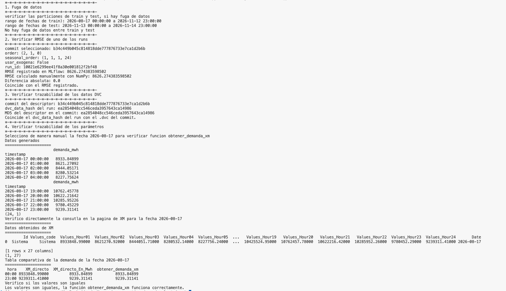
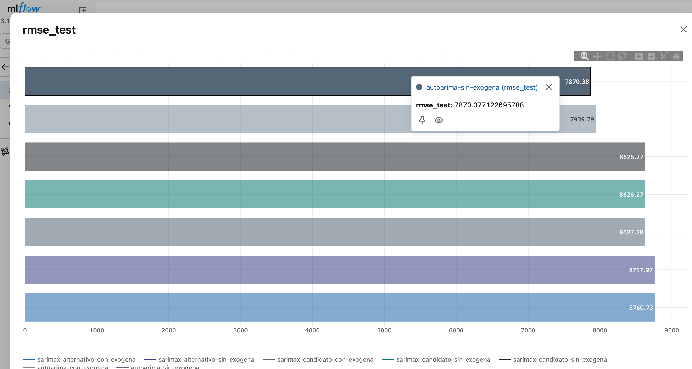
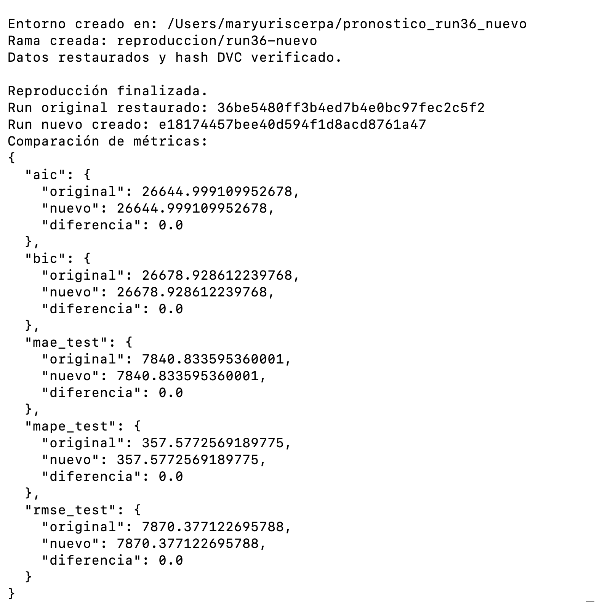
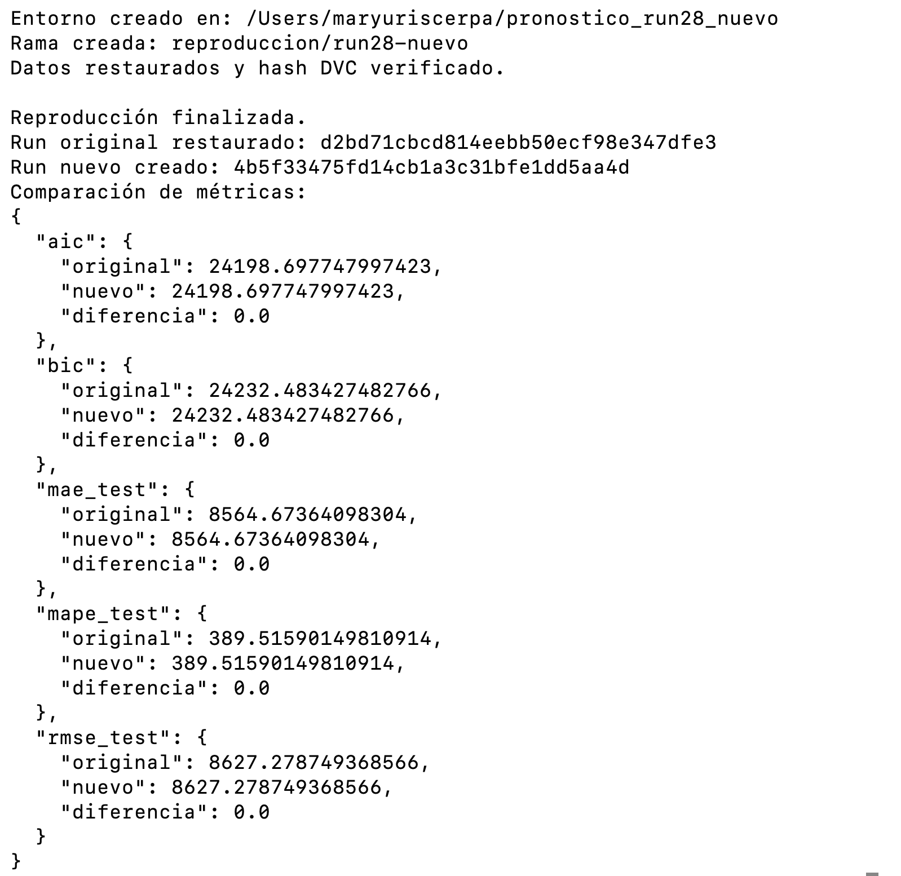

#Version 1 - Rango: 2026-08-15 00:00:00 a 2026-11-12 23:00:00
outs:
- md5: 41acd8a47b157184f5e7d26354c0ef8d
  size: 82875
  hash: md5
  path: xm_demanda.csv

#Version 2 - Rango: 2026-08-15 00:00:00 a 2026-11-13 23:00:00
outs:
- md5: a391cfb8f550999e2fe64e107af7e8ca
  size: 83768
  hash: md5
  path: xm_demanda.csv

#Version 3 - Rango: 2026-08-15 00:00:00 a 2026-11-14 23:00:00
- md5: ea2854048cc546ceda3957643ca14986
  size: 84735
  hash: md5
  path: xm_demanda.csv

# Verificaciones
Para generar este reporte usé el script donde dejé parametrizadas las revisiones
```bash
.venv/bin/python -m codigo.verificaciones_parte6 --commit b34c449
```



# Selección del mejor modelo


# Conclusión
La temperatura exógena no mejora las predicciones: en AutoARIMA aumenta el RMSE
de 7870.38 a 7939.79 MWh (0.88 %) y el MAE de 7840.83 a 7911.13 MWh (0.90 %).
En SARIMAX, su efecto sobre el RMSE es prácticamente nulo y aumenta de 8626.27
a 8627.28 MWh.
Frente al baseline estacional naive de 24 horas (RMSE 6076.99 y MAE 4368.26),
ningún modelo evaluado mejora el error de prueba; el mejor candidato lo supera
en RMSE 29.51 % y en MAE 79.50 %.
El menor AIC y BIC corresponden a SARIMAX (24197.44 y 24225.59), pero este
modelo tiene un RMSE mayor que el mejor AutoARIMA.
Por tanto, elegiría AutoARIMA sin exógena: obtuvo el menor RMSE, MAE y MAPE,
7870.38, 7840.83 y 357.58 %, aunque su complejidad automática no compense la
no coincidencia entre sus criterios de ajuste y el desempeño fuera de muestra.

# Reproducir el experimento
dvc_data_hash
: ea2854048cc546ceda3957643ca14986
git_commit
: 0a1afc03233e8bb92e36e40c0d892a514d4de192
fuente
: xm-open-meteo-dvc
supuesto_exogena
: sin_temperatura_exogena



dvc_data_hash
: ea2854048cc546ceda3957643ca14986
git_commit
: 25d159cd7b14693c70767894c548edb8c1b2b1cb
fuente
: xm-open-meteo-dvc
supuesto_exogena
: temperatura_observada_en_tra



### Se logra reproducir los mismos resultados, solo desde el run_id usando el script 
```bash
.venv/bin/python -m codigo/reproducir_desde_runid.py
```