## Reporte detallado de la entrega
Repositorio de git: https://github.com/mcerpa-git/pronostico_demanda_electrica.git
## Varias versiones de los datos
Se generan varias versiones de los datos:
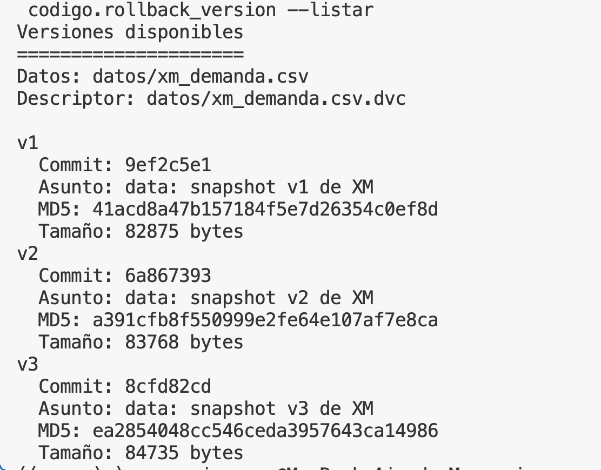
## Rollback a versión deseada de los datos
Se configura un script que permite regresar a la versión de los datos de diferentes formas.
1. Como me encontraba en la versión V3, usé el script para volver a los datos de V1.
Previsualizar una restauración:

```bash
.venv/bin/python -m codigo.rollback_version v1
```

Restaurar una versión:

```bash
.venv/bin/python -m codigo.rollback_version v1 --confirmar
```
2. Configuré manualmente los comandos a ejecutar para hacer rollback a la versión V3. Resultado de la ejecución:
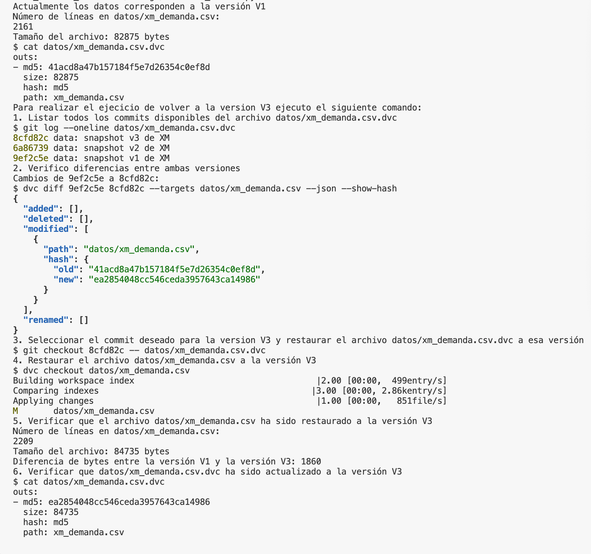
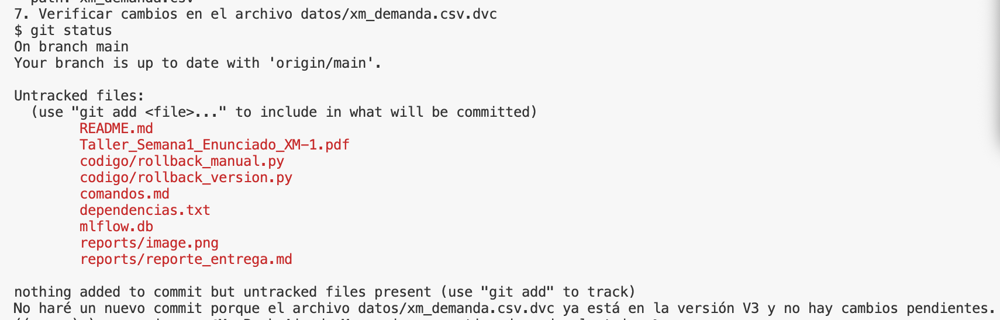

## EDA
Se realiza análisis de la V3 de los datos.

### Serie temporal
La gráfica muestra la evolución horaria de la demanda y la temperatura en la versión V3.

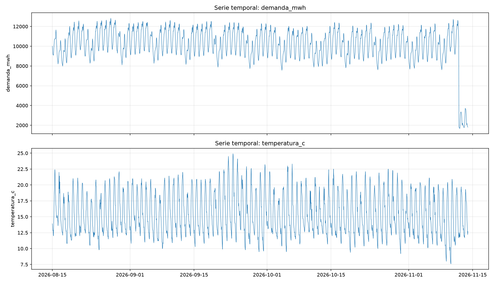

### Distribuciones
Los histogramas permiten observar la forma y frecuencia de los valores de demanda y temperatura.

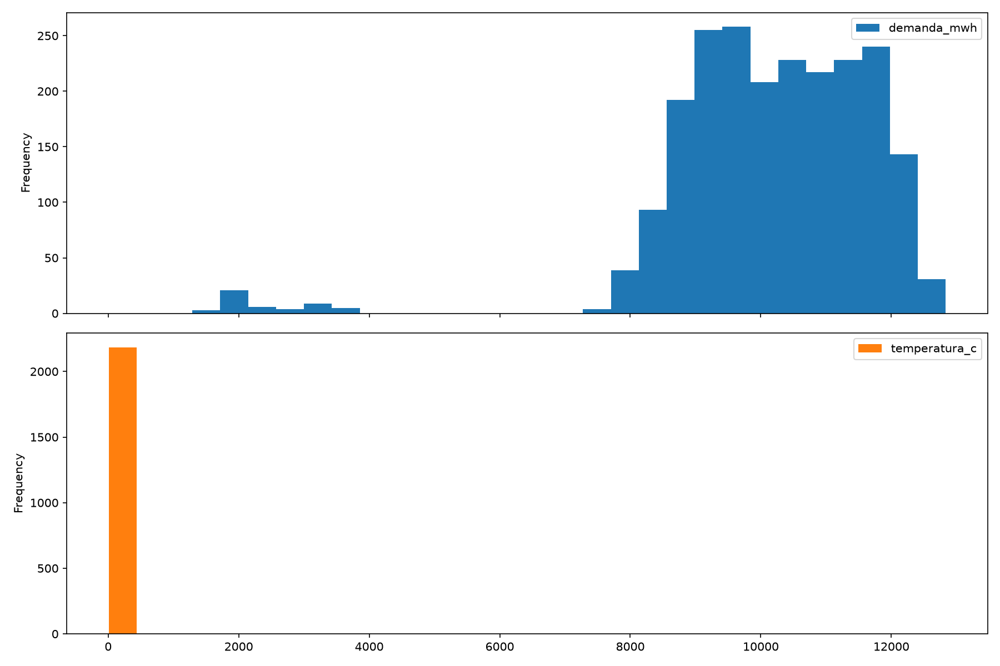

### Diagramas de caja
Los diagramas de caja ayudan a identificar visualmente los posibles valores atípicos de cada variable.

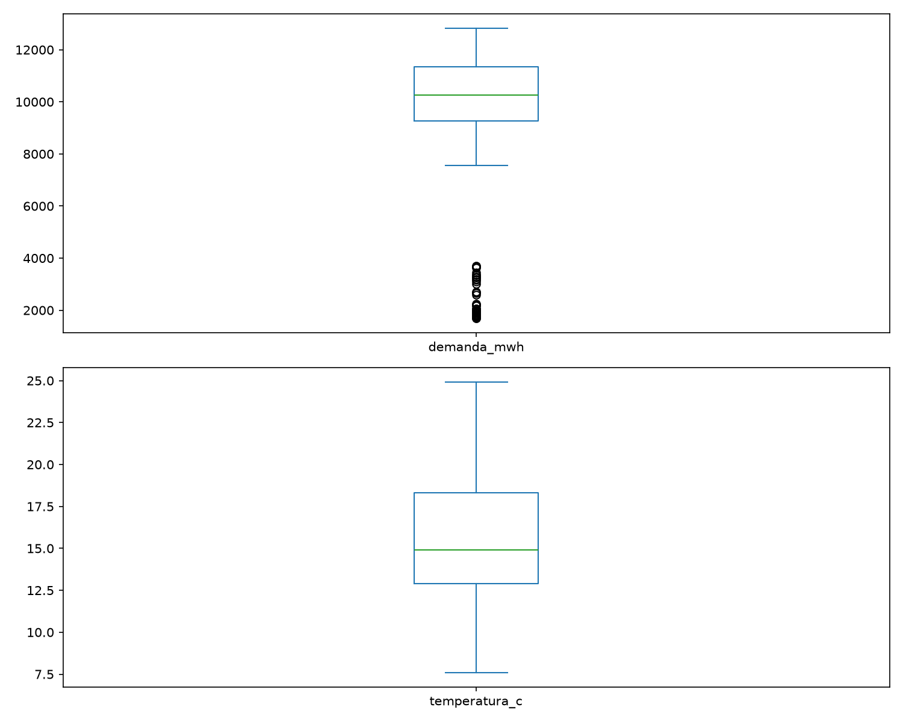

### Evidencia previa para SARIMAX
Antes del ajuste del modelo se revisan la autocorrelación, la autocorrelación parcial,
la descomposición estacional, la estacionariedad y el perfil diario horario.

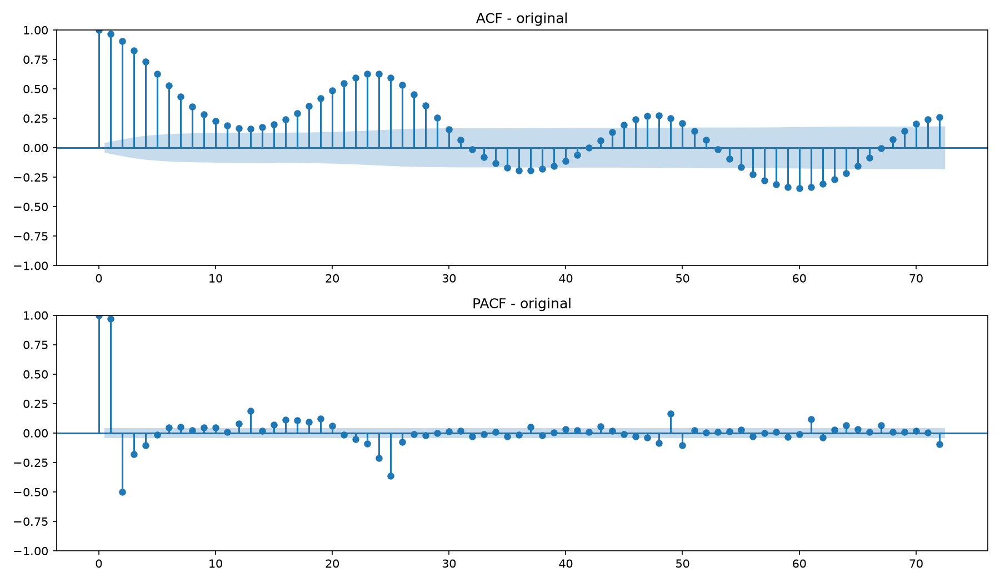

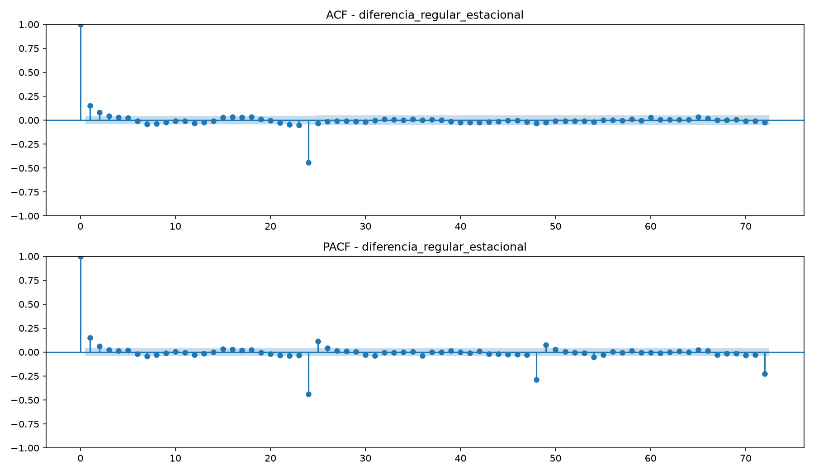

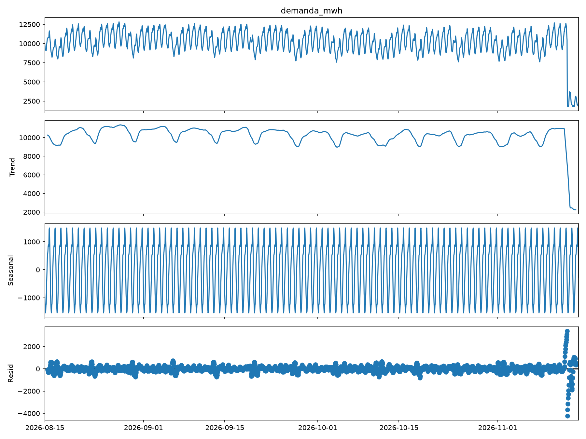

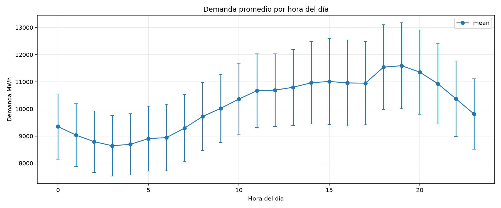


## Pipeline reproducible y baseline
1. Ejecutar pipeline con los datos en V1:
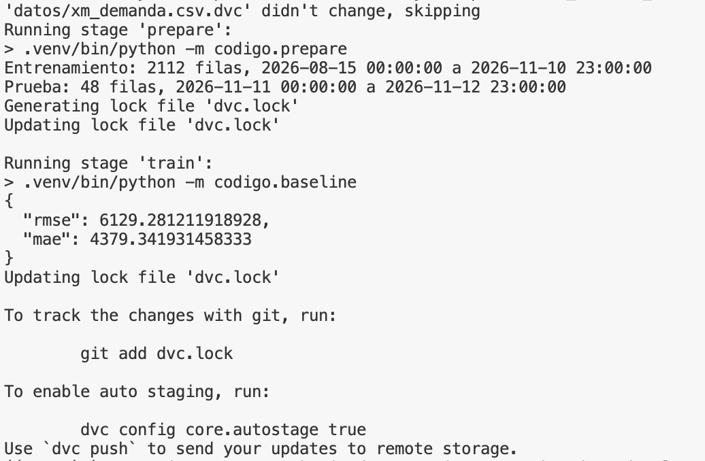
2. Volver a ejecutar:
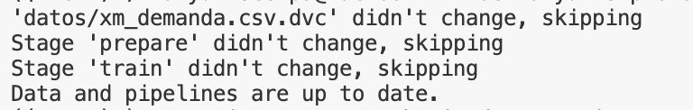

Observaciones: Como no hay cambios en los datos, se omiten las etapas.

3. Predigan antes de ejecutar qué etapas se recalcularán si cambian 
(a) un parámetro que solo usa
train: si cambio un parametro que solo usa train por ejemplo seasonal_order, no se ejecuta prepare porque los datos son los mismos, solo train.
(b) un parámetro que usa prepare: Esto genera que se ejecuté todo el pipe porque los datos de train y test cambiarían. Por ejemplo horas_prueba.
Luego verifíquenlo con dvc repro y dvc dag

# Para verificar (a) cambio seasonal_order de [1, 1, 1, 24] a [2, 1, 1, 24]
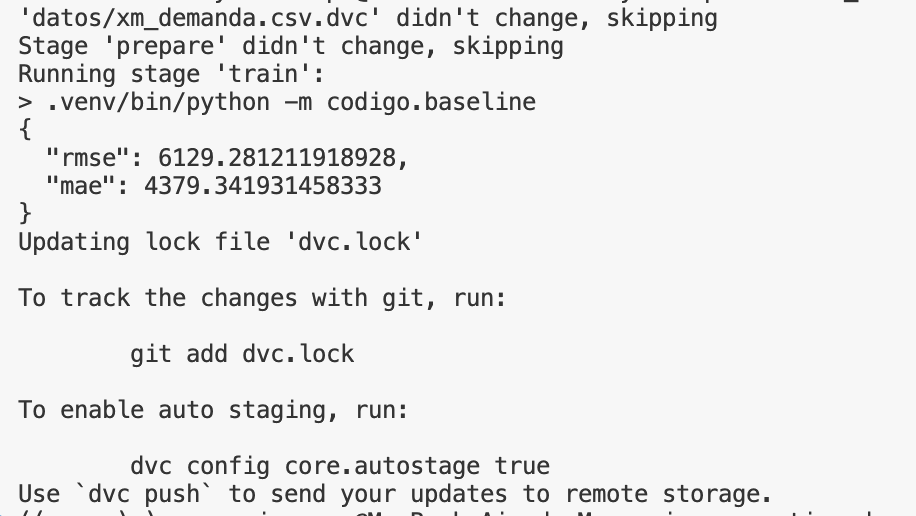
En efecto solo se ejecuta train.
# Para verificar (b) cambio dias_entrenamiento: 88 a 80
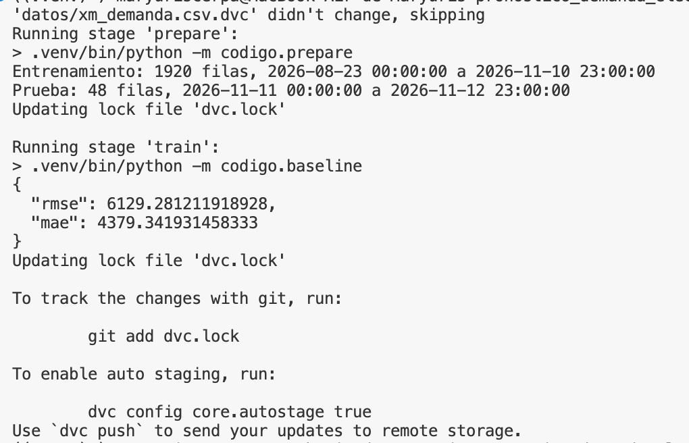
En efecto se ejecuta todo el pipe.

4. Adicionalmente voy a volver a la version V3 para volver a ejecutar el pipe como versión final.
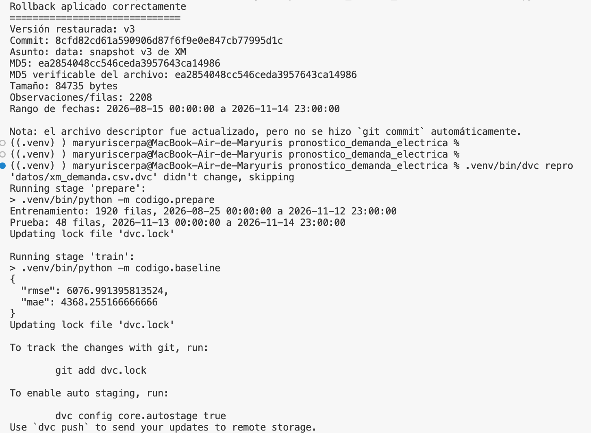

## Verificaciones
las validaciones las parametricé con 
```bash
.venv/bin/python -m codigo.verificaciones_parte6 --commit b34c449
```
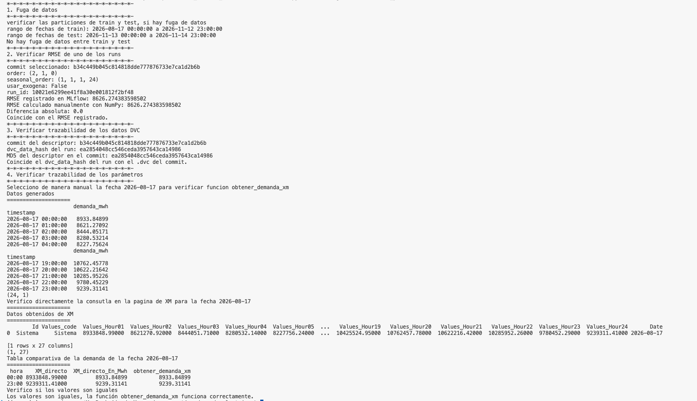